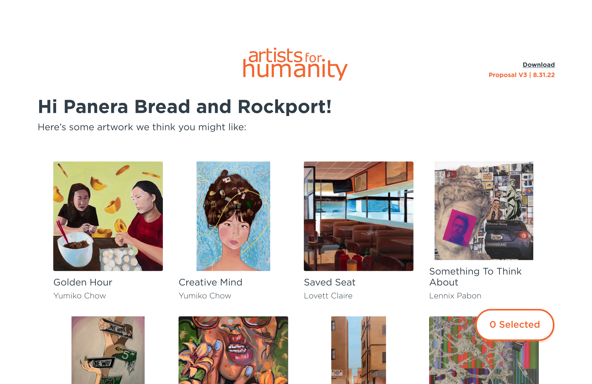
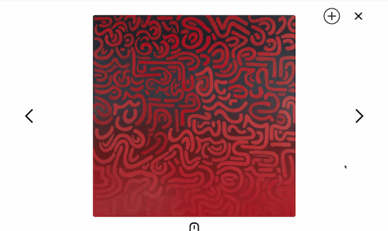
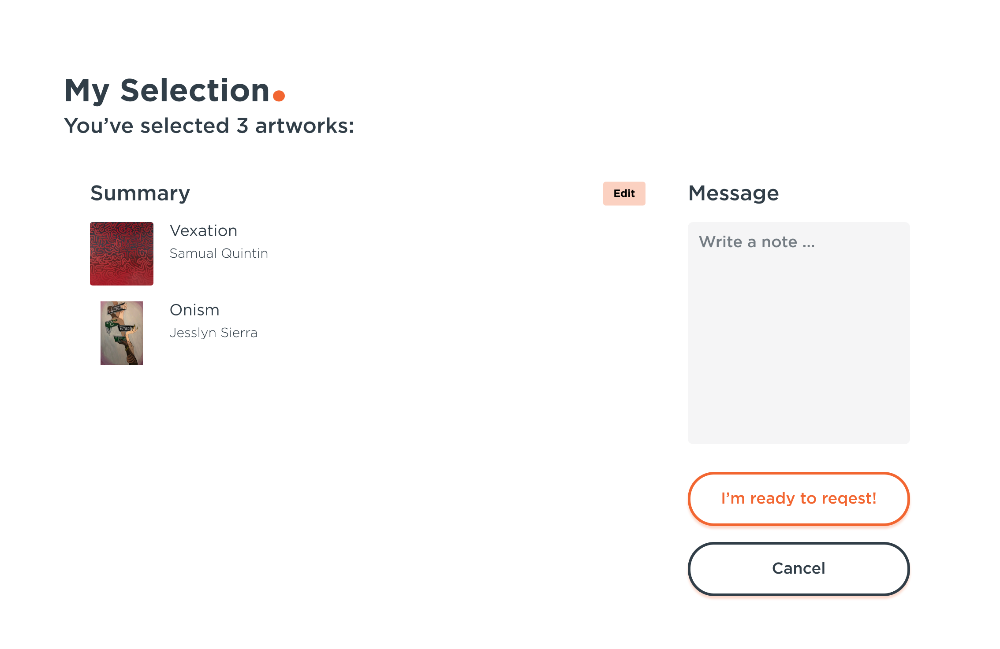
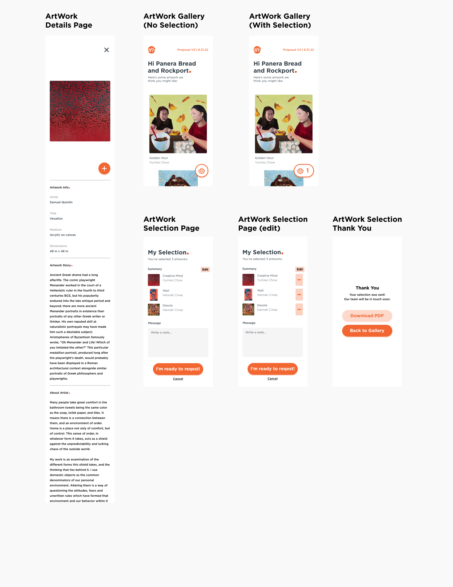

# AFH Private Gallery

## About

AFH Private Gallery is a client-facing artwork selection tool designed to simplify the art-leasing process at Artists For Humanity (AFH), a nonprofit organization supporting young artists.

Previously, AFH's Curation Team assembled artwork presentations in InDesign and emailed them to clients. Selecting and revising artwork could require months of back-and-forth emailing, creating repetitive administrative work for a small team balancing many responsibilities.

Private Gallery addressed this particular stage of the service. Curators could assemble personalized collections from AFH's existing Salesforce artwork catalog and share them through private links. Clients could browse artwork, refine their selections, and submit their preferences before the team resumed the quoting, contracting, and delivery process.

### Project Overview

|                  |                                                                           |
| ---------------- | ------------------------------------------------------------------------- |
| **Type**         | Internal product / client-facing tool                                     |
| **Organization** | Artists For Humanity                                                      |
| **Role**         | UX/UI Designer                                                            |
| **Scope**        | Workflow research, UX/UI design, prototyping, developer handoff           |
| **Deliverables** | Interface mockups, interactive prototype, handoff documentation           |
| **Outcome**      | Developed and used by the Curation Team; quantitative impact not measured |

## Design Approach

The Curation Team approached me while working with external developers on a tool inspired by existing art-gallery platforms. They needed clearer requirements and interface mockups, but recreating a full-featured platform was beyond the project's budget and technical scope.

Through informal conversations, observation of the team's workflow, and a review of client email chains, we identified a more focused opportunity: the repetitive exchange of artwork presentations and revisions after curators had already chosen pieces for a client. Together, we narrowed the project to this selection stage, where a modest intervention could ease a recurring source of friction.

I designed the client experience around **one clear task: making and submitting an artwork selection**. Rather than adding account management or automating the entire leasing service, the interface kept browsing, artwork details, and selection editing straightforward. This limited scope also made the experience more feasible to implement within the existing Salesforce architecture and available development resources.

## The Experience

The tool connects the Curation Team's existing workflow to a private, client-facing gallery.

### For Curators

Curators create a collection in Salesforce, associate it with a client, and add artwork from the organization's catalog. They then share a private gallery link. Once the client submits a selection, the team can move forward with quoting, contracts, and delivery.

### For Clients

Clients open their personalized gallery, browse the curated artwork, view details, and build a selection at their own pace. They can review, edit, and comment on their choices before submitting them, or return to the private link to make changes.

_The landing page introduces the client to their personalized artwork collection._

_Artwork details help clients evaluate individual pieces before selecting them._

_Clients can review, edit, and comment on their selection before submitting it to the Curation Team._

_The responsive layout supports the same selection process on smaller screens._

[Watch the client user flow](./AFH_Private_Gallery_Client.mp4)

## Additional Documentation

Explore the workflow, interface design, and materials prepared for implementation.

- **[Client User Flow](./AFH_Private_Gallery_Diagram.pdf)** — The proposed artwork-selection experience.
- **[Developer Handoff](./screens/AFH_Private_Gallery_Handoff.pdf)** — Interface specifications prepared for the external development team.
- **[Interactive Interface Design — Figma](https://www.figma.com/design/GgTtDfqac8hdEhEDD2E2Jr/Lo-fi-Gallery-Website--SHARE-?node-id=243-1&t=XeKINzSAc5nH9vXp-1)** — Explore the interface design.

## Beyond the Private Gallery

Following the Private Gallery's development, AFH asked me to explore a public-facing version of its artwork collection. I designed a gallery concept with a simple view interface as a proof of concept. It raised an exciting possibility: allowing people outside the organization to explore a collection previously accessible only through internal archives and Salesforce.

The concept was not developed further. Gaps in historical artwork records, including missing artist information, would have required extensive manual cataloging, while development resources remained limited. The exploration reinforced a lesson I took from Private Gallery: **the most useful digital solution is not necessarily the largest one, but the one that removes friction from a well-understood part of a service.**
