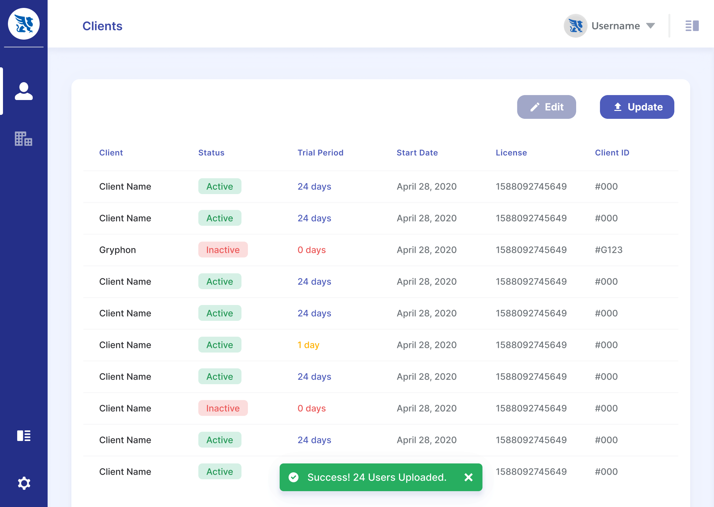
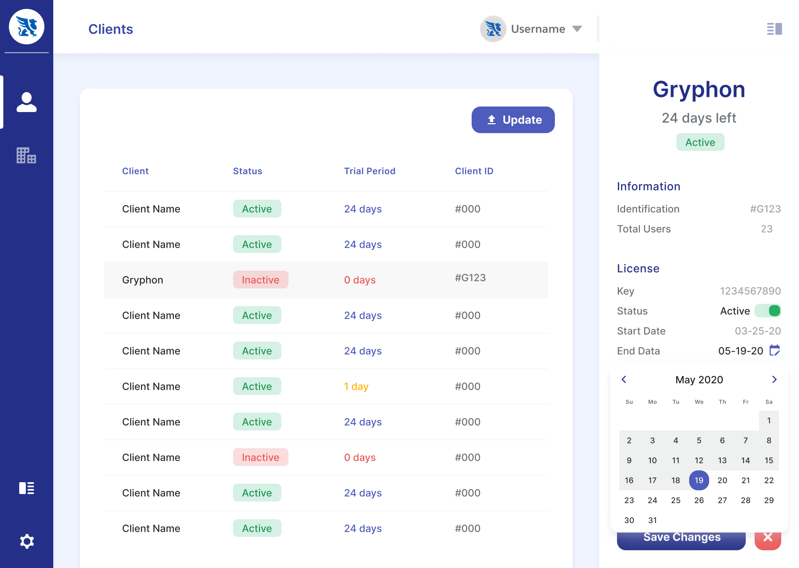
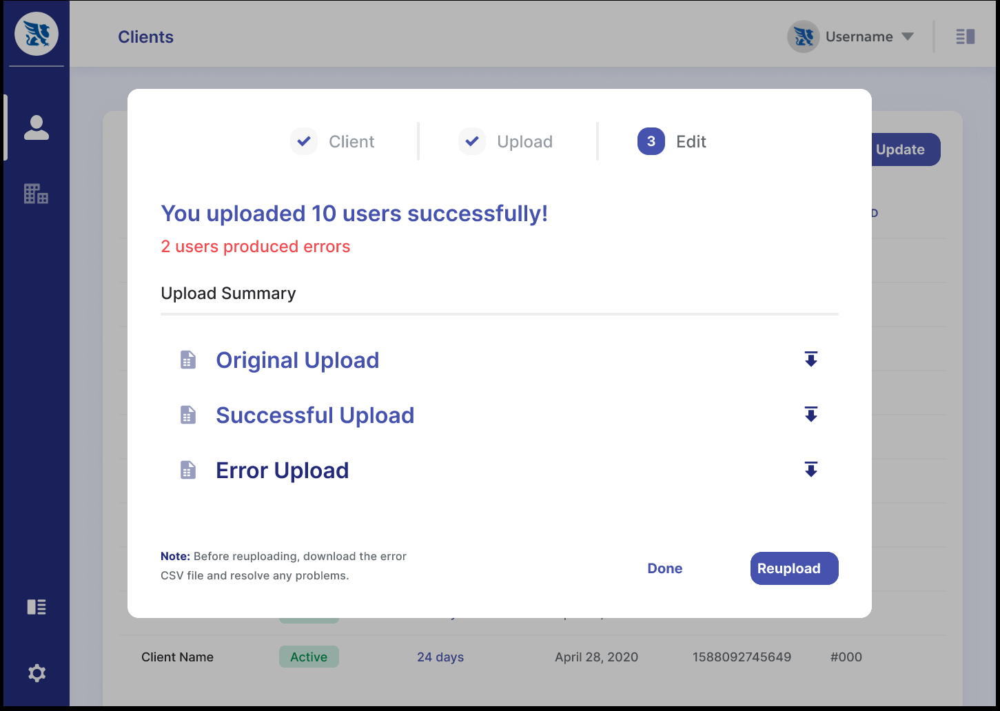
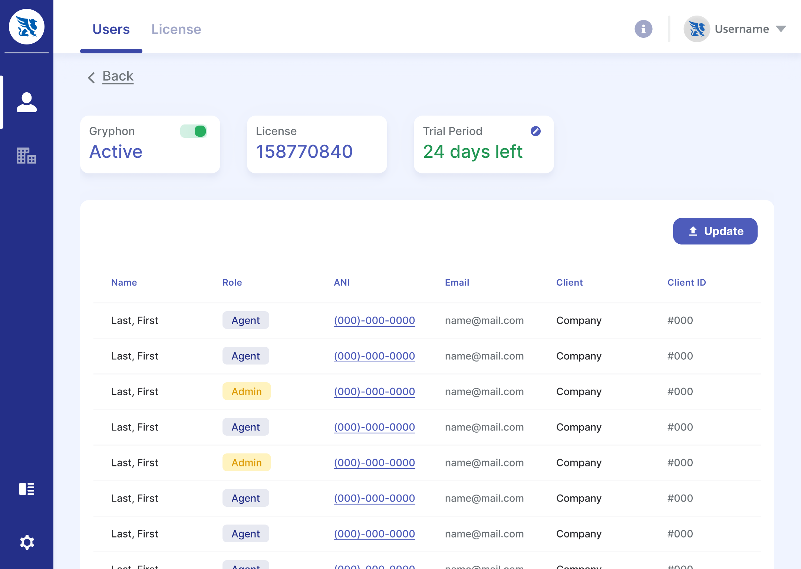

# Gryphon Client Manager

## About

Gryphon Client Manager is a functional proof of concept developed during an internal research and development initiative at Gryphon Networks (now Gryphon AI), an enterprise sales compliance software company.

The project explored whether **React Admin** could provide a practical foundation for developing a client-management interface outside the company's existing Salesforce-based product. Sales representatives could upload client records, review account and license information, update license details, and view associated contacts (agents).

As the UX Engineer, I designed and implemented the front end, working alongside a back-end developer who built the supporting API and database integration. The goal was to test a development approach—not to build a fully featured replacement for the existing product.

## Project Overview

|                   |                                                                                  |
| ----------------- | -------------------------------------------------------------------------------- |
| **Type**          | Internal R&D / Functional Proof of Concept                                       |
| **Role**          | UX Engineer — Interface Design & Front-End Development                           |
| **Collaborators** | Senior Designer, Head of Product & Back-End Developer                            |
| **Scope**         | UI Design, React Implementation, REST API Integration & Technical Evaluation     |
| **Stack**         | React Admin, TypeScript, Material UI, styled-components, React Router & REST API |
| **Deliverable**   | Working Application Connected to a Database and Back-End API                     |

## Design & Engineering Approach

The senior designer led the initial requirements and wireframes. I contributed feedback, developed the interface designs, and implemented them in React. Regular reviews with the senior designer, Head of Product, and back-end developer helped us prioritize the interactions needed to evaluate the technology.

React Admin accelerated development by providing a ready-made foundation for data tables, navigation, and API-connected management views. The trade-off became clear during customization: removing unnecessary default features and overriding the library's styling required understanding its abstractions and underlying components. I used **styled-components** alongside Material UI to adapt the interface while keeping the code focused on the proof of concept.

**CSV uploads became the clearest example of designing for both usability and implementation scope.** Rather than adding an in-browser spreadsheet editor or a manual client-creation form, we kept the workflow centered on uploading files. The back end processed each upload, accepted valid records, and returned CSV files that helped users review the results. When records were malformed, the interface displayed a notification and provided an error CSV identifying those records and their issues. Valid records still populated the client table, so an imperfect upload did not block the entire task.

This approach avoided a large set of data-entry and validation edge cases while preserving a clear recovery path for users. Implementing it required close coordination with the back-end developer as the REST API was being developed.

## The Experience

The interface focused on three tasks: **uploading clients, managing licenses, and reviewing account details**.

### Client Management

Sales representatives can upload client lists and review the successfully processed records in a table, including license information. A side panel supports quick edits to client license details without leaving the list.

_Client records and license information in the main data table._

_Editing a client's license end date from the side panel._

### Upload Feedback & Error Recovery

A successful upload returns the original file and a processed CSV formatted for the system. If some records are invalid, an additional error CSV identifies the affected clients and describes what needs correcting. The interface notifies the user while still displaying records that were accepted.

_Upload feedback and downloadable error records support correction outside the application._

[Watch the client upload workflow](./Gryphon_Client_Upload_Flow.mp4)

### Client Details

Each client has an overview of license status and a list of associated users (agents), bringing key account information into one place.

_Client license overview and associated agent records._

## Additional Documentation

- **[Interface Design — Figma](https://www.figma.com/design/ULaPsOGJhviWzSReXQ66Ky/Gryphon-POC-Mockups?node-id=0-1&t=16Gu6bJP6q7XCMp0-1)** — Explore the interface design.

## Outcome & Reflection

The application was connected to a working database and REST API and demonstrated to the product team. The R&D exercise showed that React Admin could accelerate development of a conventional management interface, while also revealing the effort involved in reshaping its built-in behaviors and visual system. I don't know whether the prototype informed later product decisions.

Working across design and engineering reinforced a lesson I continue to carry forward: **every design decision is an engineering decision.** In this project, being selective about what the interface needed to do made it possible to investigate the framework's real strengths and limits without losing focus to features outside the research goal.
