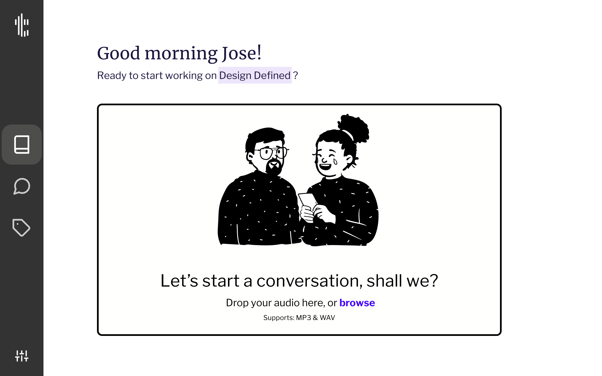
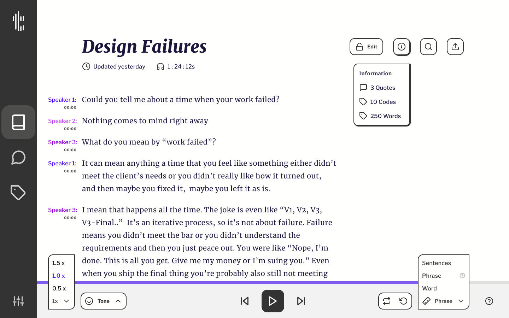
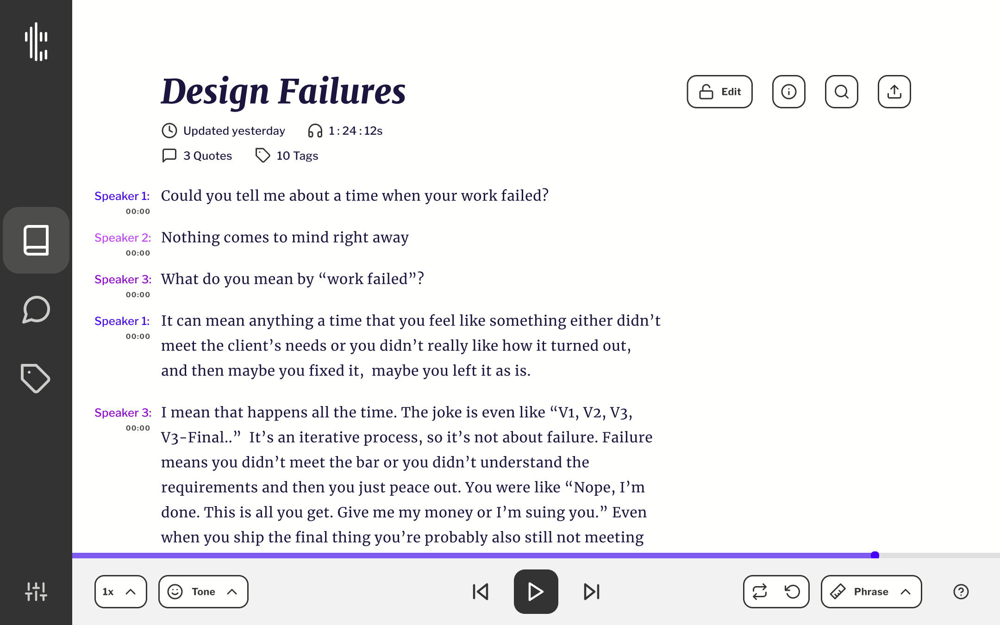
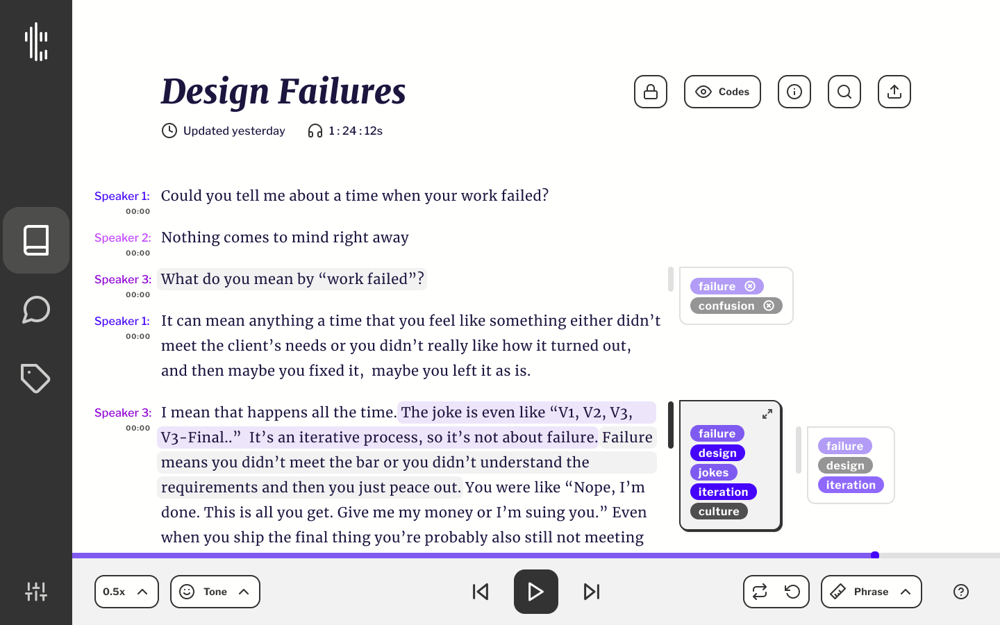
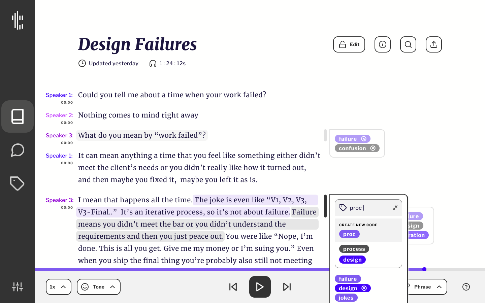

# Transcriber

## About

Transcriber is a transcription and qualitative data analysis tool designed to help researchers process audio recordings more efficiently.

Transcribing interviews and focus groups is often a time-consuming process involving repeated listening, rewinding, proofreading, and organizing information. While automated transcription can accelerate this process, manual transcription encourages active listening and a deeper understanding of the research material.

Transcriber explores a hybrid approach that combines the speed of automated transcription with the comprehension benefits of manual transcription. By streamlining repetitive tasks while keeping researchers actively engaged with their recordings, the interface aims to make transcription more efficient without sacrificing the value of human interpretation.

### Project Overview

|                 |                                                                             |
| --------------- | --------------------------------------------------------------------------- |
| **Type**        | Self-initiated university project                                           |
| **Role**        | Sole Product Designer & UX Researcher                                       |
| **Scope**       | Research, UX/UI Design, Interaction Design, Prototyping & Usability Testing |
| **Deliverable** | High-Fidelity Interactive Prototype                                         |

## Design Approach

The project originated from my experience developing a brand strategy for a nonprofit organization, where conducting stakeholder interviews revealed how time-consuming it was to transcribe, organize, and extract meaningful insights from qualitative data.

This experience inspired a design hypothesis: **What if automation could enhance a researcher's ability to understand information rather than simply replace their involvement?**

Through iterative prototyping and usability testing, I explored a hybrid transcription model that combines automated suggestions with adjustable audio playback. Breaking recordings into manageable segments allows researchers to actively engage with the material while reducing repetitive interactions.

A central design challenge was balancing advanced functionality with an interface that encouraged focus. Early evaluations revealed that displaying numerous qualitative codes and transcript metadata created visual clutter, drawing attention away from the content itself. To address this, I introduced controls to hide or reveal codes and reorganized secondary information into contextual menus.

These decisions established an information hierarchy that keeps the transcript at the center of the experience while making advanced tools available when needed.

## The Experience

Transcriber supports three stages of qualitative data processing: **transcribing, reviewing, and organizing**.

### 1. Transcribing

The transcription experience centers on a guided audio playback system that helps researchers work through recordings at their own pace.

Three features make this possible:

- **Audio Chunking:** Breaks recordings into manageable segments, allowing researchers to focus on one passage at a time instead of continuously pausing and rewinding.
- **Audio Measures:** Uses machine learning to divide recordings into words, phrases, and sentences. Researchers can navigate between these measures and adjust the level of detail based on the recording's complexity.
- **Transcription Suggestions:** Provides automated text suggestions for each audio segment. Researchers can accept these suggestions or manually transcribe the recording, combining automation with human judgment.

Together, these features are designed to reduce repetitive interactions, support careful listening, and give researchers greater control over the transcription process.

_Uploading audio recordings to a new project._

_Audio playback controls allow researchers to adjust the transcription pace, from sentence-level playback for faster transcription to word-level playback for more detailed listening._

[Watch the phrase transcription prototype](./Transcribing_Workflow_Prototype_wAUDIO.mp4)

### 2. Reviewing

Once an audio recording has been transcribed, researchers can review the transcript, follow conversations between speakers, and identify meaningful passages.

The interface supports proofreading and quote selection, allowing researchers to move from transcription to analysis within the same environment.

_Transcript of a multi-speaker recording before qualitative coding._

### 3. Organizing

Researchers can organize their findings by selecting quotes and assigning qualitative codes directly within the transcript.

Codes provide a way to categorize meaningful passages and identify themes across the research material. The interface also supports creating, managing, and cleaning up codes as the analysis develops.

_Selected quote with qualitative codes applied to the transcript._

_Contextual menu for assigning existing codes or creating new ones._

## Additional Documentation

Explore the research, design iterations, and interactive prototypes developed throughout the project.

- **[Design Process & Early Prototypes](./Transcriber_Prototype_Report.pdf)** — User flows, sketches, paper prototypes, and initial usability testing.
- **[Design & Evaluation Report](./Transcriber_Report.pdf)** — Prototype evaluations, design decisions, and final interface iterations.
- **[User Flow Diagrams](./Transcriber_User_Flows.pdf)** — Existing and proposed workflows for transcription and qualitative data organization.
- **[Interactive Interface Design — Figma](https://www.figma.com/design/SJgccghop6rfPUdPKvSH28/Web?node-id=0-1&t=ljHVa8d8Q2NMOuej-1)** — Explore the interface design.

## A Curiousity...

Transcriber concluded as a high-fidelity interactive prototype rather than a fully developed application. At the time, implementing the audio-processing algorithms required to support the proposed interactions presented significant technical challenges.

With the emergence of more capable AI models, many of those challenges are now more approachable. It would be interesting to explore how these technologies could bring the original vision to life, especially the relationship between human comprehension and intelligent automation.
