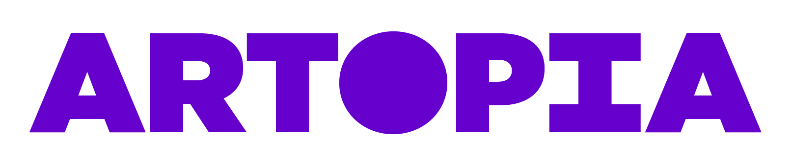
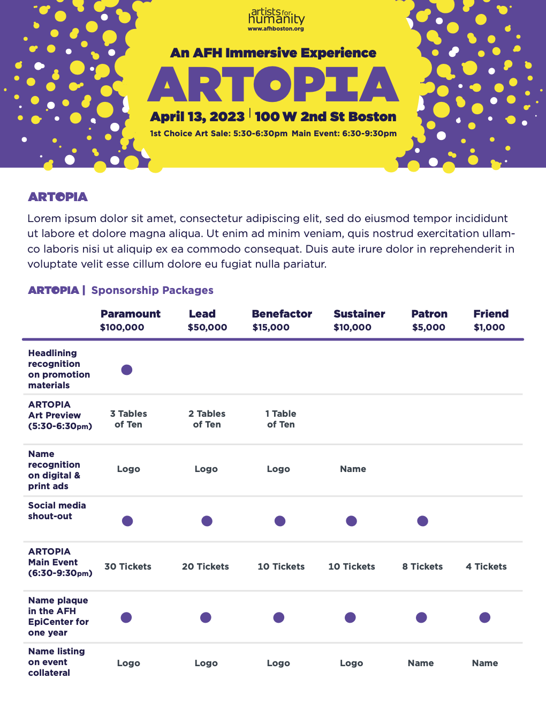
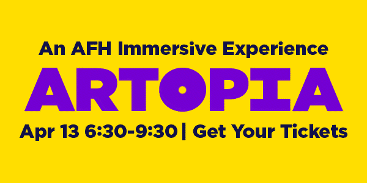
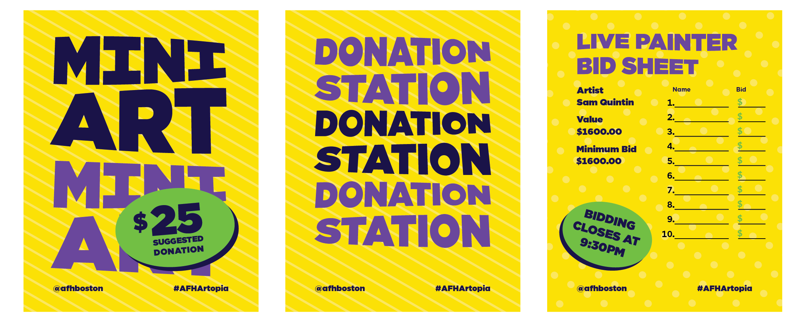
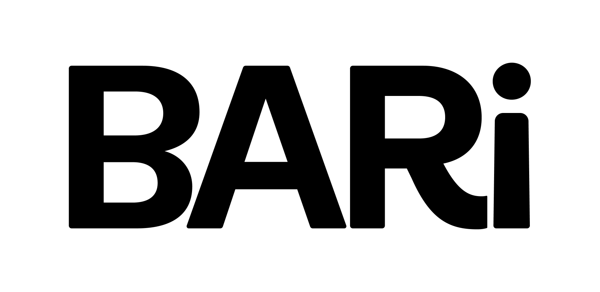
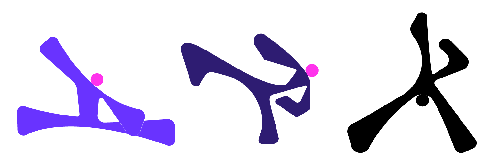
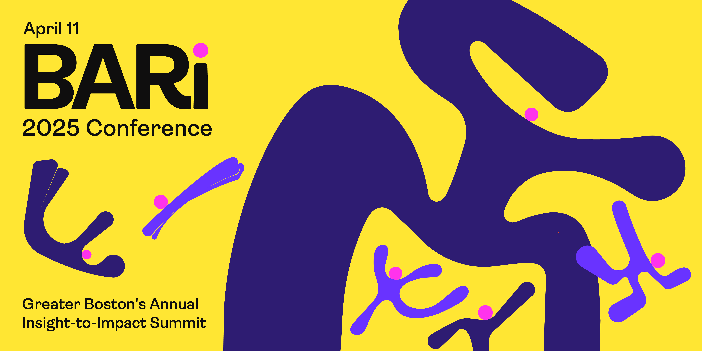
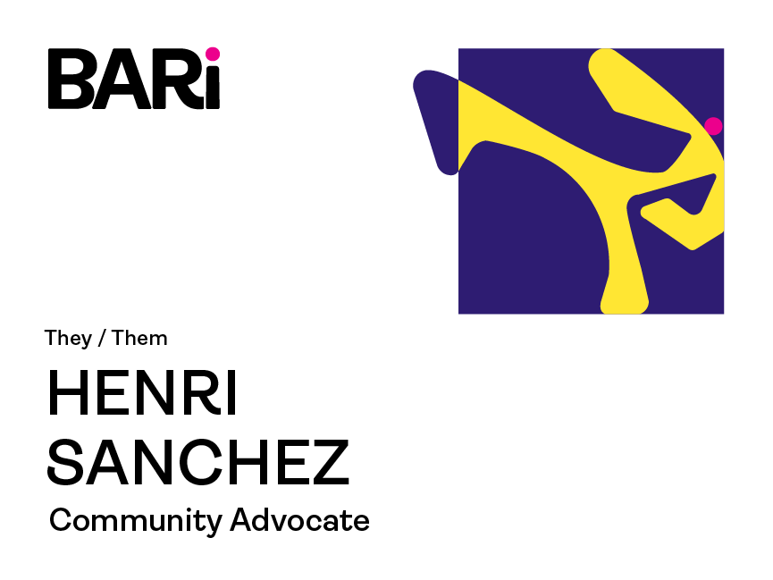
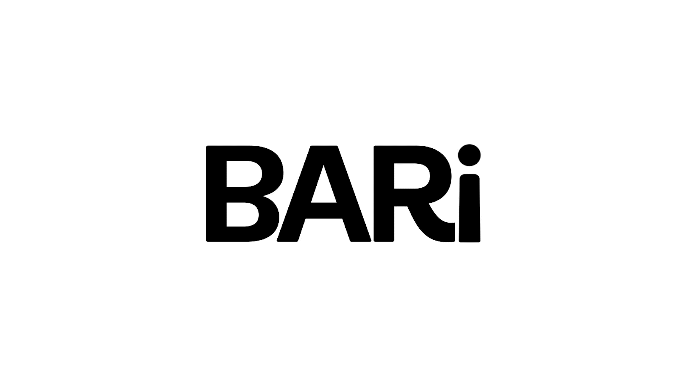

# Brand Identity & Strategy

## About

I approach visual identity as a way to give an organization or experience a personality that people can recognize and connect with. My work often uses color, texture, illustration, and play, but the visual language should always serve the people, purpose, and constraints of the project—not the other way around.

The projects below show two sides of this practice: guiding a collaborative campaign across multiple creative teams and developing an expressive visual system independently. The workshop materials at the end offer a look at how I gather perspectives and turn them into a shared direction.

## AFH ARTOPIA — Building a World Within a Brand

**Role:** In-house Visual Designer; Identity Design & Creative Direction  
**Scope:** Visual identity, campaign system, creative briefs, cross-studio direction, and production coordination

ARTOPIA was Artists For Humanity's largest annual fundraising event. With a new executive director and a new event name, the organization wanted a distinct identity that still belonged within the broader AFH brand.

Working with the marketing director, graphic design studio director, and executive director, I helped shape the direction through workshops, questionnaires, and creative reviews. The idea of **ARTOPIA as its own world** became the foundation for the identity I designed. We carried over AFH's typeface, yellow, and playful spirit, then introduced a cosmic purple chosen by the executive director along with touches of neon green, richer textures, and motion. The **O** in ARTOPIA became a portal into this world: a fitting device for a fundraiser that was also a celebration.

_Wordmark works with AFH's existing identity and introduces a new visual world._

### From Identity to Event

Extending the identity across a full campaign required coordinating AFH’s different creative studios within a limited timeline and budget. I guided the creative process through briefs, concept reviews, and production support. Completed work was then presented to leadership for feedback and approval.

The identity was used throughout the event, including materials made by teams beyond those I directly coordinated. The result was a shared visual language built through many contributors, rather than a campaign produced by one designer alone.

_Fundraising mailer designed directly for the development team._

_Employee email signature extending the campaign into everyday communication._

_Wayfinding developed in collaboration with the graphic design studio, with room for their own interpretation of the system._

[Watch the ARTOPIA Triptych Subway Ad](./Artopia/ARTOPIA_Public_Trans_Triptych_Ad.mp4)
_Transit advertisement produced with the animation studio; I supplied animatics, brand specifications, and creative direction._

[Watch the ARTOPIA TV spot](./Artopia/ARTOPIA_TV_Spot.mp4)
_TV spot produced with the animation and video studios, with my involvement in concept guidance, animatics, review, and delivery._

## BARI 2025 — Putting People at the Center of Data

**Role:** Sole Visual Identity Designer (independent studio practice)  
**Scope:** Identity system, illustrations, motion, and event graphics

After designing the 2024 conference identity, I was commissioned to develop a new direction for BARI 2025, a Boston-area gathering focused on research, public policy, and community collaboration.

The event team wanted to retain the illustration-led approach of the previous year, but move away from its brighter neon palette and place greater emphasis on community. Photography was outside the budget, while abstract data visualization felt too impersonal for the event they envisioned. I developed a character-driven identity that put people not data at the center of the story.

The system combined expressive illustrations, an updated color palette, and a playful animated logo. The finished identity appeared across a limited set of conference touchpoints, reflecting the event's production budget. I also delivered individual illustrations and reusable assets so the team could extend the system on their own.

_The conference logo anchors an illustration-led visual system._

_An adaptable cast of characters emphasizes the people behind the research._

_Illustration and typography come together in an event banner._

_Nametag example, the system extends to attendee materials._

_What began as a playful experiment became a favorite of the organizing team. A dancing logo used as a presentation bumper._

**Supporting work:** [2024 concept presentation](./Bari/2024/BARI_2024_Final_Concept_Prez.pdf) · [2025 concept presentation](./Bari/BARI_2025_Final_Concept_Prez.pdf) · [2025 Identity one-pager](./Bari/BARI_2025_Identity_One_Pager.pdf) · [Animated colored bumper with music](./Bari/BARi_2025_Video_Bumper_Color.mp4)

## Strategy & Facilitation

Visual identities begin before the visuals. I research and adapt workshop exercises, facilitate conversations, and synthesize different perspectives into a direction people can recognize as their own. I've often found that stakeholders agree more than they realize, they simply use different words to express similar ideas. Part of the designer's work is finding the common thread and shaping it into a clear story.

I use image-led presentations and guided activities to make space for discussion, rather than asking slides to carry the entire conversation. These examples show how I approach both independent workshops and collaborative strategy work:

- **[Brand Strategy Workshop](./Workshops/Brand_Strategy_Sprint_Clarity.pdf)** — Exercises developed and facilitated to help clients clarify their direction.
- **[Brand Naming Workshop](./Workshops/Brand_Naming_Intro_P1.pdf)** — Intro to a structured process for exploring and evaluating naming ideas.
- **[AFH Brand Refresh Concept](./Workshops/Brand_Refresh_Toolkit_Strategy.pdf)** — A proposed brand direction developed through a broader, collaborative refresh effort.
